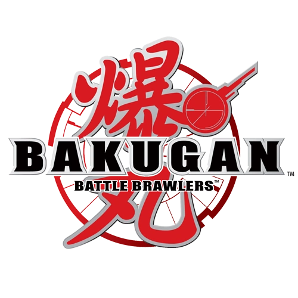
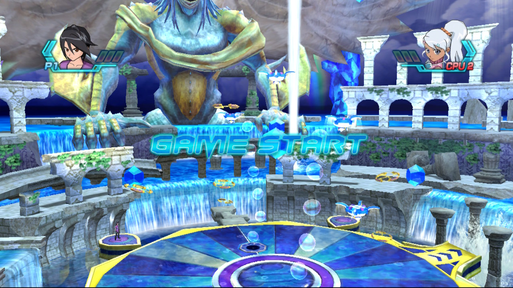
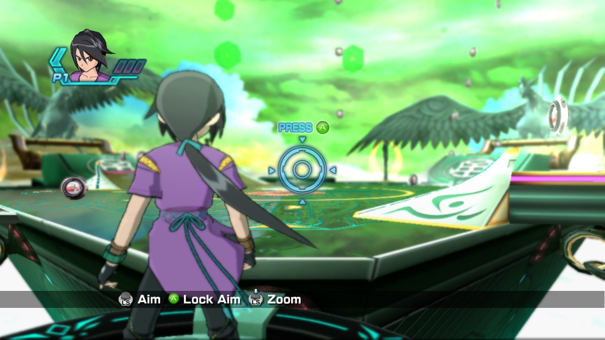
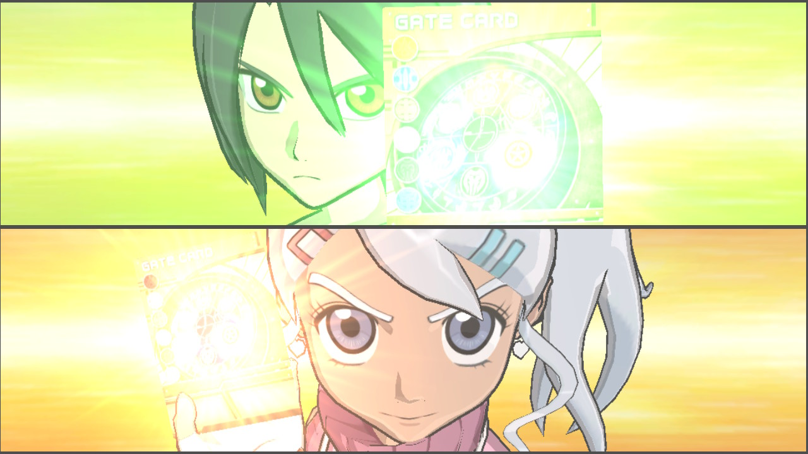
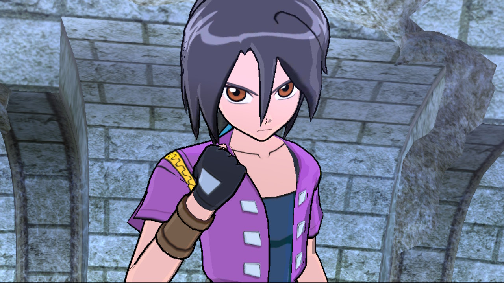
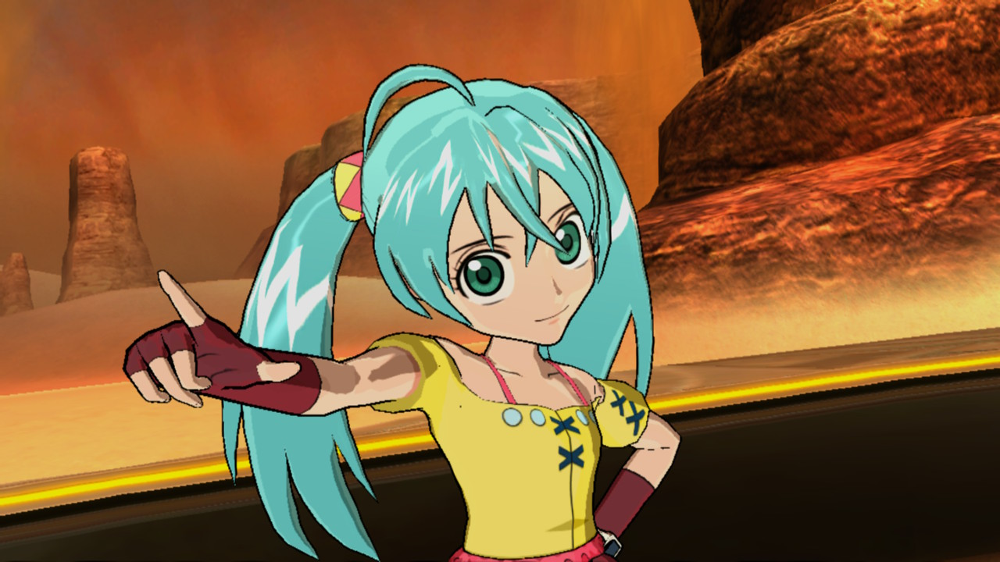
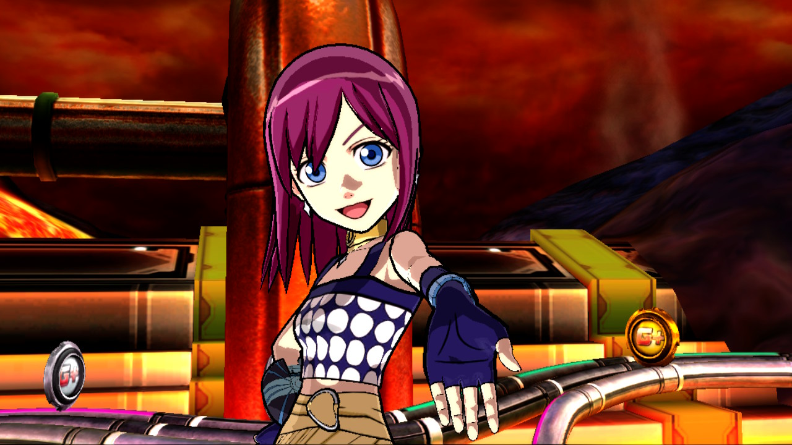

<div align=center>



</div>
<h1 align=center>Bakugan: Battle Brawlers — Nintendo Switch port</h1>

A native Nintendo Switch port of the Xbox 360 version of **Bakugan: Battle Brawlers** (2009).

Who asked for it? Don't ask me lol.

It's not an emulator. The PowerPC code of the game's `default.xex` is statically recompiled to C++ with
[ReXGlue](https://github.com/rexglue/rexglue-sdk) and compiled for the Switch. Since **0.2.0** the game is drawn by
Renut's Direct3D-level renderer ([reNut](https://github.com/masterspike52/reNut), written by masterspike52 for the PC) running
directly on the Switch's own graphics API, **deko3d**. That Switch side (the deko3d back end, the shader chain and the render-thread
work) is **ChanseyIsTheBest's**, from banjo-nx, sa2-nx and peggle2-nx, which this port follows. The game's Direct3D calls are drawn
as they are, with no emulated GPU command ring, no EDRAM model and no Vulkan driver (up to 0.1.2 the game was drawn by a
native Vulkan renderer on NVK, which is still in the source tree). It runs at **30 FPS at the console's stock clocks**, at the game's
own resolution: the 3D scene at 1120×584 stretched to the 1280×720 screen, the HUD and cutscenes at 1280×720.

> [!NOTE]
> You need your own copy of the Xbox 360 game: the extracted disc (the folder with `default.xex` and `media/`).
> No game files, no code generated from them and no binaries are in this repository, and none are distributed.

> [!TIP]
> **Installer page: https://wiredlainn-afk.github.io/Bakugan-NX/** — pick your disc, get the SD card package. Everything
> runs in your browser. See [How to install](#how-to-install).

## Screenshots

<table>
  <tr>
    <td></td>
    <td></td>
  </tr>
  <tr>
    <td></td>
    <td></td>
  </tr>
  <tr>
    <td></td>
    <td></td>
  </tr>
</table>

<sub>Captured on the Switch in handheld mode.</sub>

## Status

**0.2.0** boots and plays on a Switch in handheld mode. Measured on the console at the stock clocks (the GPU at the official 460.8 MHz
handheld profile):

- menus, cutscenes and the arenas tested so far: a locked 30 fps at the game's own resolution, with no dynamic resolution and no
  sharpening. The water arena, the heaviest scene so far, uses about 19-22 ms of the GPU in busy fights (33 ms are available) and
  9-18 ms of the render thread;
- the intro movies and the movies during play work (the four logos at the start are skipped; the language select, the copyright
  screen and the opening cinematic stay);
- the arenas look soft because of the game's own depth of field and bloom: the scene's resolution is not the cause (a 1.25x scene
  test cost about 6 ms in busy fights and looked the same);
- not tested yet: docked mode, a 60 fps mode (the game is a 30 fps game and its logic may follow the frame rate), and the "Xbox 360"
  texts and button icons (they are still the Xbox ones).

0.1.x (the native renderer: 720p handheld and up to 1080p docked with a dynamic render scale, 540-630p in the heaviest arenas) is
documented in [docs/performance-history.md](docs/performance-history.md).

## How to install

**0.2.0:**

1. Extract `bakugan-nx-0.2.0.zip` into `sdmc:/switch/`.
2. Put the files of your own copy of the game (the extracted disc: `default.xex` and `media/`) in `game_root/`.

Your `bakugan-nx` folder should look like this:

```text
/switch/bakugan-nx/
  bakugan.nro                (the game's shaders for deko3d are inside)
  bakugan.toml               (optional: your settings; everything else is compiled in)
  cache/deko3d_shaders.bin   (the compiled shader variants; the game adds the ones it has not seen yet)
  cache/pipeline_list.bin    (the pipelines to prepare at the start)
  game_root/                 (default.xex and media/ of your disc)
  logs/                      (bakugan.log and flight.txt, written by the game)
```

Launch it with a game override (hold **R** while starting an installed title) or a forwarder, with a **39-bit address
space**. Album applet mode does not give the game enough memory.

> [!CAUTION]
> **The first time you play**, the game compiles the shader variants it has not seen yet, so **it can stutter for a moment** in new
> places. They are saved in `cache/deko3d_shaders.bin` and later sessions start smoothly.

**0.1.x (the native renderer)** used the installer page, **https://wiredlainn-afk.github.io/Bakugan-NX/**: pick your disc, get the
SD card package with `bakugan_shaders.mesp` and `cache/bakugan_native_pipelines.bin`. 0.2.0 does not read those files.

To build everything yourself instead, see [docs/building.md](docs/building.md); the page is described in
[installer/README.md](installer/README.md).

## Settings

`bakugan.toml` next to the NRO is optional and holds the player's options (face-button layout by letter or by position, Joy-Con
orientation, per-player button mapping, which movies are skipped). The fixed settings are compiled in
(`app/bakugan_switch_defaults.toml`), including the renderer choice: without a `bakugan.toml` the game runs with Renut on deko3d.
`bakugan_skip_movies` takes 0 (every movie plays), 4 (the default: the logos named in `bakugan_skip_movie_names` are skipped) or 3
(every movie is skipped). The dynamic render scale of 0.1.x belongs to the native renderer and is not used.

## What is in this repository

| Folder | Contents |
|---|---|
| `app/` | The port: application hooks, configuration for the code generator, Renut's renderer (`src/renut_engine`) with plume's deko3d back end and the uam shader compiler (`thirdparty/plume`, `thirdparty/uam`), the old native renderer (`src/me`), CPU and GPU enhancements |
| `app/tests/` | The settings files of the test builds (the release has none): see [app/tests/README.md](app/tests/README.md) |
| `CLAUDE.md` | The engineering log and process guide of the port (what was measured, what worked, the traps), for people porting another game with the same tools |
| `sdk/` | The ReXGlue SDK fork with the Horizon (Switch) layer and this port's changes |
| `shaders/` | XenosRecomp (Xenos microcode to HLSL) and the shader library tools; the deko3d shader chain (HLSL, SPIR-V, GLSL, uam) is in `tools/deko3d_*.py` |
| `tools/` | Analysis, code generation, build and packaging scripts (`tools/win` for Windows) |
| `mesa/` | How to get the NVK driver the 0.1.x NRO links (0.2.0 uses deko3d and does not need it) |
| `installer/` | The browser installer page of 0.1.x (shaders are made from the player's disc) |
| `docs/` | Build instructions, notes from the first stages and the performance history |

##  AI slop notice

Did AI help me save countless hours of optimization and trial and error? Yes, can't hide it.
Is the game itself slop? Also yes, let's be real, the franchise sucks and has been sucking since 2014 or something lol. This game though? It's pretty peak.

## Credits

This port exists thanks to the work of NebadasSwifty (masseffect-nx), ChanseyIsTheBest (banjo-nx, sa2-nx and peggle2-nx: bringing
Renut to the Switch on deko3d, the deko3d back end in plume, the uam shader chain and the render-thread work this version is built on),
masterspike52 (reNut, the Direct3D-level renderer of the PC port), StevensND (nfsmw-nx and the SDK's Switch layer), Tom Clay and the Xenia authors (ReXGlue SDK), hedge-dev
(XenosRecomp) and danfromtico (mesa-switch, used up to 0.1.x). Details and licenses: [THIRD_PARTY_NOTICES.md](THIRD_PARTY_NOTICES.md)
(the entries for reNut, plume, uam and the deko3d work still have to be added there).

The code of this repository is GPL-3.0 (`LICENSE`); the SDK and the shader tools keep their own licenses (see the notices).
Bakugan and Battle Brawlers belong to their owners; this project is unofficial and not affiliated with them.
