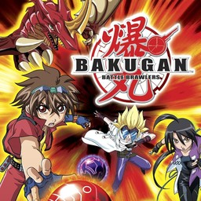

<div align=center>



</div>
<h1 align=center>Bakugan: Battle Brawlers — Nintendo Switch port</h1>

A native Nintendo Switch port of the Xbox 360 version of **Bakugan: Battle Brawlers** (2009).

It's not an emulator. The PowerPC code of the game's `default.xex` is statically recompiled to C++ with
[ReXGlue](https://github.com/rexglue/rexglue-sdk) and compiled for the Switch, and the game is drawn by a native
Vulkan renderer running on NVK (Mesa). It targets **30 FPS at the console's stock clocks**, at 720p in handheld mode and
up to 1080p docked, with a dynamic render scale that gives up resolution only when the GPU needs it.

> [!NOTE]
> You need your own copy of the Xbox 360 game: the extracted disc (the folder with `default.xex` and `media/`).
> No game files, no code generated from them and no binaries are in this repository, and none are distributed.

> [!TIP]
> **Installer page: https://wiredlainn-afk.github.io/Bakugan-NX/** — pick your disc, get the SD card package. Everything
> runs in your browser. See [How to install](#how-to-install).

## Status

Boots and plays on a Switch in handheld mode and docked. Measured on the console at the stock clocks:

- menus, cutscenes, the story and light battles: 720p, a steady 30 fps;
- heavy battle arenas (Aquos, Fire, Haos, 2x2, Battle Royale): the render height steps down to 540-630p to keep 30 fps (95 % or more
  of the time at 28 fps or higher); sharpened with CAS when below native;
- the limit there is the GPU (EDRAM emulation, about 22 ms per frame at 540p), not the CPU. See
  [docs/performance-history.md](docs/performance-history.md).

## How to install

1. Open the installer page: **https://wiredlainn-afk.github.io/Bakugan-NX/**.
2. Choose your game (the disc image `.iso`, or the extracted disc folder with `default.xex`) and press
   **Create bakugan-nx.zip**. Everything runs in your browser and the game files never leave your computer: the page
   checks your edition, downloads the build and makes the shaders from your disc.
3. Extract the zip into `sdmc:/switch/`.

Your `bakugan-nx` folder should look like this:

```text
/switch/bakugan-nx/
  bakugan.nro
  bakugan.toml               (settings, written at the first start)
  bakugan_shaders.mesp       (the game's shaders, made from your disc)
  bakugan_shaders.mesp.idx
  cache/bakugan_native_pipelines.bin   (pipeline cache)
  game_root/                 (default.xex and media/ of your disc)
```

Launch it with a game override (hold **R** while starting an installed title) or a forwarder, with a **39-bit address
space**.

To build everything yourself instead, see [docs/building.md](docs/building.md); the page is described in
[installer/README.md](installer/README.md).

## Settings

`bakugan.toml` next to the NRO holds the player's options (anti-aliasing, face-button layout by letter or by position,
Joy-Con orientation, per-player button mapping). The fixed settings are compiled in
(`app/bakugan_switch_defaults.toml`). The dynamic render scale, its floors (450p handheld, 720p docked) and the
sharpening are documented in the comments of that file and in [docs/performance-history.md](docs/performance-history.md).

## What is in this repository

| Folder | Contents |
|---|---|
| `app/` | The port: application hooks, configuration for the code generator, the native renderer (`src/me`), CPU and GPU enhancements |
| `app/tests/` | The settings files of the test builds (the release has none): see [app/tests/README.md](app/tests/README.md) |
| `CLAUDE.md` | The engineering log and process guide of the port (what was measured, what worked, the traps), for people porting another game with the same tools |
| `sdk/` | The ReXGlue SDK fork with the Horizon (Switch) layer and this port's changes |
| `shaders/` | XenosRecomp (Xenos microcode to HLSL) and the shader library tools |
| `tools/` | Analysis, code generation, build and packaging scripts (`tools/win` for Windows) |
| `mesa/` | How to get the NVK driver the NRO links |
| `installer/` | The browser installer page (shaders are made from the player's disc) |
| `docs/` | Build instructions, notes from the first stages and the performance history |

##  AI slop notice

Did AI help me save countless hours of optimization and trial and error? Yes, can't hide it.
Is the game itself slop? Also yes, let's be real, the franchise sucks and has been sucking since 2014 or something lol. This game though? It's pretty peak.

## Credits

This port exists thanks to the work of NebadasSwifty (masseffect-nx), ChanseyIsTheBest (sa2-nx), StevensND (nfsmw-nx and
the SDK's Switch layer), madelrandel-blip (NFSMW Recompiled), Tom Clay and the Xenia authors (ReXGlue SDK), hedge-dev
(XenosRecomp) and danfromtico (mesa-switch). Details and licenses: [THIRD_PARTY_NOTICES.md](THIRD_PARTY_NOTICES.md).

The code of this repository is GPL-3.0 (`LICENSE`); the SDK and the shader tools keep their own licenses (see the notices).
Bakugan and Battle Brawlers belong to their owners; this project is unofficial and not affiliated with them.
